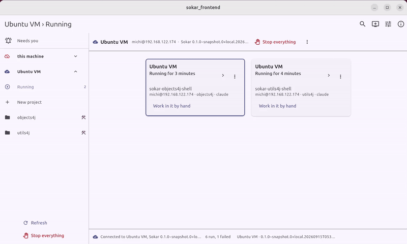

# porelo-frontend

> **Early bird - work in progress.** Porelo is not stable yet: until release 1.0.0, its code, commands
> and file formats can change without notice.

The desktop interface for [Porelo](https://github.com/porelo-ai/porelo), on Linux and on Windows.

**Download:** on Linux, the `porelo-frontend` package from Porelo's own package repository; on Windows,
a ZIP from [the Windows section](https://porelo-ai.github.io/frontend/#windows) of the chapter's page,
with how to check it before unpacking.

Porelo runs AI coding agents in locked-down containers: no network except what a project declares, no
credential the agent can read, and nothing leaves the machine without somebody approving it. This
interface does what Porelo's command line does, on this computer and on machines reached over ssh,
without a terminal. It is not a backend: it runs no task and decides nothing itself, and everything it
does goes through the daemon's socket. Maven only drives its build; the one `pom.xml` has no modules.

**Documentation: [porelo-ai.github.io/frontend](https://porelo-ai.github.io/frontend/)**, the interface's chapter of all of Porelo's documentation.

## Install

From the same package repository as Porelo itself: `porelo-frontend`, for Debian, Ubuntu and Fedora.
How to add the repository, and the first steps after installing, are on the
[chapter's page](https://porelo-ai.github.io/frontend/).

## More

- [Building it and working on it](https://github.com/porelo-ai/porelo-frontend/blob/main/build.md)
- [The backend API](https://github.com/porelo-ai/porelo-frontend/blob/main/doc/Backend-API.md): how a client talks to Porelo
- [Decisions](https://github.com/porelo-ai/porelo-frontend/blob/main/doc/decisions.md): what holds, and what it costs
- [Requirements](https://github.com/porelo-ai/porelo-frontend/blob/main/issues/README.md): what is still to do

## Licence

GNU General Public License, version 3 only (`GPL-3.0-only`), the same as the rest of Porelo. The
full text is in [`LICENSE`](https://github.com/porelo-ai/porelo-frontend/blob/main/LICENSE), and every package installs it beside the program.
